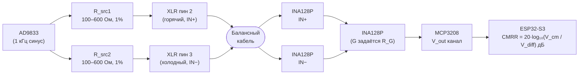
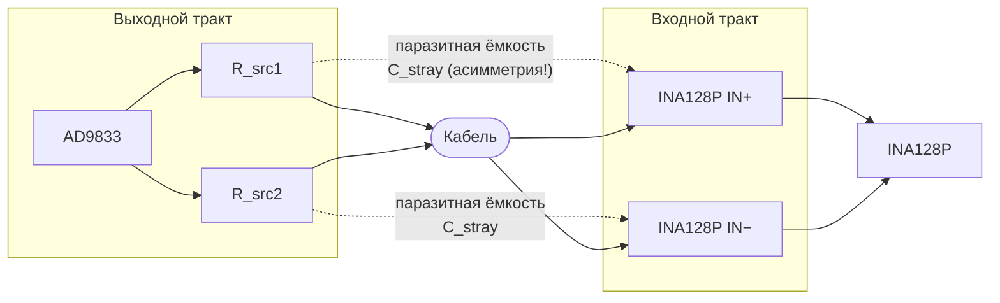

# Разбор блока CMRR · Минимальные требования и методика

## Зачем этот документ

CMRR — самый недооценённый тест в плане. Он выглядит «как простая формула» ($20 \log_{10}$ от отношения напряжений), но на макетной плате с проводами-соплями разница между «60 дБ» и «40 дБ» легко оказывается шумом измерения, а не свойством кабеля. Этот документ описывает, **что конкретно нужно сделать**, чтобы цифры были осмысленными.

Документ нужен прежде всего Ване (как лиду по железу) и Владу (как автору прошивки CMRR). Читается до того, как Ваня начинает разводить тракт INA128P на макетке — иначе придётся переделывать.

---

## Что такое CMRR в контексте этого проекта

**Common-Mode Rejection Ratio** — способность балансного кабеля подавлять синфазную помеху. На оба сигнальных проводника подаётся одинаковый сигнал (это и есть синфазный, common-mode). Идеальный балансный кабель такой сигнал полностью подавляет на выходе. Реальный — подавляет лишь частично, и степень подавления — это и есть CMRR.

**Формула:**

$$\text{CMRR (дБ)} = 20 \log_{10}\!\left(\frac{V_\text{common-mode input}}{V_\text{differential output}}\right)$$

**Что тестируется на самом деле.** Мы не тестируем CMRR _кабеля_ в чистом виде. Мы тестируем CMRR **системы «кабель + наш тракт измерения»**. Если наш тракт сам по себе даёт 50 дБ подавления, мы никогда не увидим у кабеля CMRR выше 50 дБ — упрёмся в потолок собственного прибора.

**Пороги из [ФТТ](requirements.md) (ФТ-2.2):**

- Отлично: > 60 дБ
- Удовлетворительно: 40–60 дБ
- Плохо: < 40 дБ

Это значит, что **наш прибор должен давать собственное подавление минимум 70–80 дБ**, иначе мы не сможем уверенно различить «отлично» и «удовлетворительно» — оба упрутся в наш потолок.

---

## Требования к сигнальному тракту

### Источник синфазного сигнала

AD9833 выдаёт несимметричный синус на одном выходе. Чтобы получить **истинный common-mode сигнал**, этот сигнал надо одновременно подать на оба сигнальных проводника кабеля с **минимально возможным рассогласованием**.

**Минимум:**

- Один и тот же сигнал с выхода AD9833 разветвляется на оба провода через **согласованные резисторы** (например, 1% точность, идеально — подобранные по парам вручную из партии резисторов 0.1%)
- Рассогласование резисторов источника напрямую превращается в **фальшивую разностную компоненту**, которую прибор засчитает как «недостаточное подавление кабелем»
- Номинал резисторов источника: 100–600 Ом (не критично, главное — равенство)

**Лучше:**

- Сигнал проходит через **буферный операционный усилитель** с низким выходным импедансом, и уже оттуда разветвляется на обе линии. Это снижает влияние рассогласования нагрузки
- Если такой ОУ не добавлен в первой ревизии — это сразу ограничивает потолок прибора на уровне ~50–55 дБ

### Измерение разностного выхода

INA128P ([ADR-002](../adr/002-ina128p-selection.md)) — инструментальный усилитель с паспортным CMRR ≥ 100 дБ при усилении 100 и более. Это достаточно хороший запас, **но только при правильной обвязке**:

- **Резистор задания коэффициента усиления** (между пинами 1 и 8) — критично. Используется один резистор $R_G$, его стабильность влияет на усиление, но **не** на CMRR напрямую
- **Равенство импедансов источника** на инвертирующем и неинвертирующем входах — критично. Если один вход «видит» 100 Ом, а второй 150 Ом — CMRR собственно микросхемы падает с 100 дБ до 40–50 дБ
- **Конденсаторы по питанию** — 100 нФ керамика непосредственно у ножек питания, плюс 10 мкФ электролит на линии. Без этого на высоких частотах CMRR проседает
- **Короткие провода на макетке** — петли на входах работают как антенны для сетевых 50 Гц наводок, которые потом вылезают в виде нестабильных измерений

### Питание

- Общая земля между AD9833, INA128P, MCP3208, ESP32-S3 — **одной точкой** (звездообразная земля). Петли по земле = паразитные наводки = шум CMRR
- Питание INA128P — желательно двухполярное (±5 В или ±9 В), потому что INA128P по природе — биполярная микросхема. С однополярным питанием 5 В работает, но требует искусственной средней точки и ограничивает динамический диапазон
- Если живём на однополярном питании — средняя точка формируется делителем + буферным ОУ (не просто двумя резисторами — это опять даст рассогласование)
- В устройстве питание идёт от Li-Ion 18650 через TP4056 — для аналоговой части, скорее всего, понадобится отдельный преобразователь (повышающий или инвертирующий), это надо учесть в схеме

---

## Прямые наводки: изоляция выходного и входного трактов

Устройство одновременно **генерирует** сигнал (выходной тракт: AD9833 → разъёмы кабеля) и **измеряет** его (входной тракт: INA128P → MCP3208). Оба тракта находятся на одной макетке. Часть сигнала неизбежно проходит от выходного тракта к входному напрямую — минуя кабель. Это называется **прямой наводкой** (direct feed-through, crosstalk).

### Почему это важно именно для CMRR

При измерении CMRR выходной тракт подаёт **одинаковый** сигнал на оба проводника кабеля (синфазный). INA128P на входе вычитает два сигнала и выделяет разность. Если прямая наводка **одинакова** на обоих входах INA128P — она синфазна и подавляется самой микросхемой (это безопасно). Опасность возникает при **асимметричной** наводке: если выходной провод оказался ближе к пину IN+ INA128P, чем к пину IN−, на входе усилителя появляется паразитная дифференциальная составляющая, неотличимая от «утечки» кабеля. Это занижает измеренный CMRR.

### Количественная оценка для макетки

На частоте 1 кГц (рабочая частота CMRR-теста) с типичной паразитной ёмкостью $C_\text{stray} = 10\,\text{пФ}$ между проводами:

$$Z_C = \frac{1}{2\pi \cdot f \cdot C_\text{stray}} = \frac{1}{2\pi \times 1000 \times 10 \times 10^{-12}} \approx 16\,\text{МОм}$$

При выходном импедансе источника ~200 Ом напряжение наводки на входе INA128P:

$$V_\text{coupled} \approx V_\text{source} \times \frac{200}{16\,000\,000} \approx 0.001\%\; V_\text{source} \approx -100\,\text{дБ}$$

Даже при асимметрии 50% (один вход получает вдвое больше, чем второй) результирующая дифференциальная составляющая — около −106 дБ. Это **не ограничивает** наши измерения при аккуратной разводке.

Проблема возникает на беспорядочной макетке с длинными параллельными проводами: при 100 пФ паразитной ёмкости и 50% асимметрии потолок опускается до ~86 дБ — это по-прежнему выше нашего требования 65 дБ, но запас сокращается. При ещё более небрежном монтаже потолок может упасть ниже.

### Меры

- **Пространственное разделение**: выходные провода (от AD9833 к разъёмам кабеля) держать на противоположном конце макетки от входного тракта (INA128P, MCP3208)
- **Скрутка пар**: входные провода к IN+ и IN− INA128P скрутить между собой — симметричная наводка на оба провода будет подавляться микросхемой
- **Не прокладывать выходные провода вдоль входных**: параллельный пробег увеличивает паразитную ёмкость линейно с длиной

### Как проверить наличие проблемы

Запустить тест CMRR **без подключённого кабеля** (разъёмы оставить пустыми). Любой сигнал, который прибор «измеряет» — это прямая наводка от выходного тракта. Записать это значение как $\text{CMRR}_\text{direct floor}$.

| Результат                                                               | Интерпретация                                                                       |
| ----------------------------------------------------------------------- | ----------------------------------------------------------------------------------- |
| $\text{CMRR}_\text{direct floor} > 80\,\text{дБ}$                       | Наводка не влияет на измерения, разводка достаточно хорошая                         |
| $65\,\text{дБ} \leq \text{CMRR}_\text{direct floor} \leq 80\,\text{дБ}$ | Наводка ограничивает потолок вблизи нашего требования; стоит улучшить разводку      |
| $\text{CMRR}_\text{direct floor} < 65\,\text{дБ}$                       | Прибор не способен достоверно измерить CMRR > 65 дБ; необходимо пересмотреть монтаж |

$\text{CMRR}_\text{direct floor}$ должен быть выше $\text{CMRR}_\text{ceiling}$ (из калибровки Шага 2). Если $\text{CMRR}_\text{direct floor} < \text{CMRR}_\text{ceiling}$ — прямая наводка является главным ограничением, а не качество тракта INA128P.

---

## Методика калибровки

Без калибровки прибор покажет цифры, но они не будут связаны с реальным CMRR кабеля. Калибровка — обязательный этап, не опциональный.

### Шаг 1 — Калибровка опорного V_common_mode

Измеряется амплитуда синфазного сигнала **на входе** кабеля, а не на выходе AD9833. Причина: резисторы источника падают часть напряжения, и реальное напряжение на проводниках отличается от выходного.

- Подать сигнал 1 кГц, амплитуду условно зафиксировать
- Измерить амплитуду непосредственно на одном из сигнальных проводников с помощью MCP3208. При сигнале > 3.3 В (VREF) использовать делитель напряжения
- Записать это значение как $V_\text{cm,cal}$

Это делается один раз при первом запуске прошивки после сборки и записывается в NVS (энергонезависимая память ESP32).

### Шаг 2 — Калибровка потолка прибора

Цель: понять, какой CMRR прибор даёт **без кабеля** (идеальный «кабель» — короткое замыкание двух входов).

- Замкнуть оба сигнальных проводника разъёма XLR на один проводник (физически, перемычкой)
- Запустить тест CMRR
- Значение, которое покажет прибор, — это его **собственный потолок**. Запомнить как $\text{CMRR}_\text{ceiling}$

Если $\text{CMRR}_\text{ceiling} < 60\,\text{дБ}$ — прибор не готов к работе с реальными кабелями. Нужна доработка схемы (буферный ОУ, подбор резисторов, проверка развязки питания).

Если $\text{CMRR}_\text{ceiling}$ в диапазоне 60–70 дБ — работаем, но знаем, что кабели с CMRR выше потолка мы не различаем. В прошивке: если измерение даёт значение в пределах 3 дБ от $\text{CMRR}_\text{ceiling}$ — отправлять результат с флагом «at instrument limit».

### Шаг 3 — Калибровка на эталонных кабелях

- Взять **заведомо хороший** XLR-кабель (новый, от известного производителя, короткий — 1 м)
- Измерить. Ожидаемое значение: 60–80 дБ
- Взять **заведомо плохой** кабель (старый, дешёвый, заметно потрёпанный)
- Измерить. Ожидаемое значение: < 50 дБ
- Если два кабеля не различаются прибором на ≥15 дБ — схема недостаточно чувствительна

Эти замеры фиксируются в `docs/hardware/cmrr-calibration.md` как baseline — и становятся опорными при всех последующих проверках.

---

## Критерий готовности CMRR к демо

Раздел применим только если железо заказано (Б-плюс 1, [scope-triggers.md](scope-triggers.md)). Если Proteus-симуляция не подтвердилась к 3 мая и железо не заказывалось — CMRR на реальном железе переходит в Этап 4.

CMRR на реальном железе относится к уровню **«Идеально»** — не к «Цели». «Цель» достижима даже без CMRR (достаточно одного рабочего теста по BLE).

К 17 мая (ревью Б-плюс 3 / Б-минус 2, [scope-triggers.md](scope-triggers.md)) CMRR на реальном железе считается готовым, если:

- [ ] $\text{CMRR}_\text{ceiling} \geq 65\,\text{дБ}$
- [ ] Эталонный хороший кабель устойчиво показывает ≥ 55 дБ
- [ ] Эталонный плохой кабель устойчиво показывает ≤ 45 дБ
- [ ] Повторные измерения одного и того же кабеля дают разброс не более ±3 дБ
- [ ] Значение не скачет от касания проводов макетки

Если к 17 мая хотя бы один пункт не выполнен — уровень «Идеально» к 28 мая недостижим: CMRR на реальном железе переносится в Этап 4, демо строится на уровне «Цель» (тест целостности по BLE) или ниже. Полный алгоритм приоритетов — Б-плюс 3 из [scope-triggers.md](scope-triggers.md).

---

## Типичные проблемы и как их распознать

| Симптом                                        | Вероятная причина                                                | Что делать                                                                     |
| ---------------------------------------------- | ---------------------------------------------------------------- | ------------------------------------------------------------------------------ |
| Значение скачет ±10 дБ между запусками         | Петли по земле, наводки 50 Гц                                    | Проверить звездообразную землю, добавить экран на входных проводах             |
| Все кабели показывают CMRR ~40 дБ              | Упёрлись в потолок прибора ($\text{CMRR}_\text{ceiling}$ низкий) | Подобрать резисторы источника, добавить буферный ОУ                            |
| Значение «плавает вниз» при касании проводов   | Антенный эффект на входах                                        | Укоротить провода, скрутить сигнальные пары                                    |
| Хороший кабель и плохой — одинаковые цифры     | Либо потолок прибора, либо неправильная подача common-mode       | Сначала проверить $\text{CMRR}_\text{ceiling}$, затем симметричность источника |
| Значение зависит от амплитуды входного сигнала | Нелинейность тракта, перегрузка INA128P                          | Снизить амплитуду, проверить динамический диапазон                             |
| Значение зависит от частоты                    | Это нормально — CMRR частотозависим                              | Фиксировать частоту 1 кГц для MVP                                              |

---

## Итого

CMRR — это не «одна строка прошивки». Это отдельное поднаправление работы на 1.5–2 недели с рисками, которые могут не решиться в срок. Ключевое:

1. Схема должна быть спроектирована с нуля под требование $\text{CMRR}_\text{ceiling} \geq 65\,\text{дБ}$, а не «подключим INA128P и посмотрим»
2. Калибровка — обязательный этап с фиксацией baseline на эталонных кабелях
3. К 17 мая у команды должны быть **цифры**, а не «похоже, работает» — это вход в ревью [scope-triggers.md](scope-triggers.md), Б-плюс 3 / Б-минус 2
