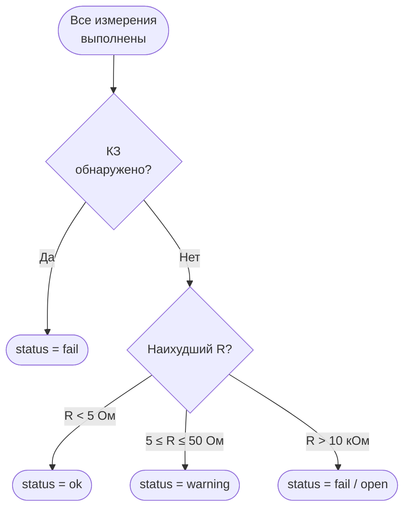

# Разбор блока Целостности · Минимальные требования и методика

## Зачем этот документ

Тест целостности выглядит тривиальным: «прозвонить каждый проводник мультиметром». На практике — это первый тест, который должен работать безупречно, потому что он единственный, отнесённый к категории **Must** в [триггерах объёма](scope-triggers.md). Если CMRR или АЧХ не успеют к демо, целостность обязана работать на реальном кабеле без заглушек.

Документ нужен Владу (прошивка) и Ване (железо). Читается до разводки макетной платы: выбор R_ref и способ обнаружения КЗ влияют на то, как именно будут подключены разъёмы к мультиплексору.

---

## Что измеряется в контексте этого проекта

Тест целостности решает три задачи одновременно:

1. **Сопротивление проводника** — показывает реальный омический контакт. Нормальный аудиокабель даёт < 1 Ом на метр; «предупреждение» (5–50 Ом) сигнализирует об окислении, плохом обжиме или механическом износе
2. **Обрыв** — проводник не проводит ток вообще: кабель оборван, вилка не обжата, внутренний разрыв под изоляцией
3. **Короткое замыкание** — два проводника, которые не должны быть соединены, замкнуты между собой: нарушение изоляции, перепутанный монтаж, дефект разъёма

**Пороги из [ФТТ](requirements.md) (ФТ-2.2):**

| Статус `s`  | Условие                                         | Примечание            |
| ----------- | ----------------------------------------------- | --------------------- |
| `"ok"`      | R < 5 Ом                                        | Нормальный проводник  |
| `"warning"` | 5 Ом ≤ R ≤ 50 Ом                                | Износ, окисление      |
| `"open"`    | R > 10 кОм (или V_mid > 95 % V_supply)          | Обрыв                 |
| `"short"`   | Напряжение проникает на изолированный проводник | КЗ между проводниками |

Итоговый статус пакета `result:continuity` — по худшему проводнику: `"ok"` / `"warning"` / `"fail"` (при обрыве или КЗ).

---

## Принцип измерения

### Делитель напряжения

```
  V_supply (GPIO, 3.3 В)
       │
  ┌────┴────┐
  │  R_ref  │  470 Ом, 1%   (опорный, точный)
  └────┬────┘
       │
       ├──────────────────── V_mid ──── IN+ MCP3208
       │
  ┌────┴────┐
  │ R_cable │  (проводник кабеля — неизвестное)
  └────┬────┘
       │
      GND
```

**Формула:**

$$R_\text{cable} = R_\text{ref} \times \frac{V_\text{mid}}{V_\text{supply} - V_\text{mid}}$$

**Частные случаи:**

- $V_\text{mid} \to 0$ — $R_\text{cable} \approx 0$ → возможное КЗ на землю; нужна перекрёстная проверка
- $V_\text{mid} \to V_\text{supply}$ — ток не течёт → обрыв ($R_\text{cable} \to \infty$)

### Почему MCP3208, а не внутренний ADC ESP32

Встроенный ADC ESP32 нелинеен на ±5–10% и зависит от температуры — для омических измерений непригоден. MCP3208 — 12-bit SAR АЦП (LSB = 0.8 мВ при VREF = 3.3 В) с погрешностью ±0.05% — достаточно для уверенного различения «0.8 Ом» и «4.9 Ом». При R_ref = 470 Ом разница в напряжениях между этими точками составляет ~29 мВ — около 36 отсчётов. Усреднение 32–64 отсчётов снижает шум в 5–8 раз, что даёт практическое разрешение ~0.05 Ом в нижней части диапазона. Обоснование выбора — [ADR-009](../../docs/adr/009-mcp3208-selection.md).

---

## Требования к схеме

### Выбор R_ref

Два ограничения задают диапазон допустимых значений:

**Снизу — ток через GPIO.** Рекомендуемый максимум GPIO ESP32-S3 — 12 мА. При $V_\text{supply} = 3.3\,\text{В}$ и $R_\text{cable} = 0$ (КЗ) через R_ref течёт максимальный ток:

$$I_\text{max} = \frac{V_\text{supply}}{R_\text{ref}} \quad\Rightarrow\quad R_\text{ref,min} = \frac{3.3\,\text{В}}{0.012\,\text{А}} = 275\,\text{Ом}$$

**Сверху — разрешение в нижней части диапазона.** При $R_\text{cable} = 5\,\text{Ом}$ (граница `"ok"` / `"warning"`) и $R_\text{ref} = 470\,\text{Ом}$:

$$V_\text{mid} = 3.3 \times \frac{5}{470 + 5} = 34.7\,\text{мВ}$$

С PGA=8 (диапазон ±256 мВ) LSB = 7.8 мкВ → 34.7 мВ даёт ~4 450 отсчётов — более чем достаточно.

**Рекомендуемое значение: R_ref = 470 Ом, допуск 1%.** Один резистор на канал; все четыре экземпляра (R11–R14 в [BOM](../../hardware/bom/bom.md)) желательно из одной партии, хотя идентичность пар R_ref здесь не так критична, как в тракте CMRR.

### Напряжение источника V_supply

Реальное напряжение GPIO ESP32-S3 отличается от 3.3 В (обычно 3.25–3.35 В). MCP3208 использует VREF = 3.3 В — диапазон входа 0–3.3 В, делитель не нужен. Измерять V_supply при каждом включении через делитель 1:2 на свободный канал MCP3208 и подставлять реальное значение в формулу.

### Разрешение MCP3208 и компенсация усреднением

MCP3208 не имеет встроенного PGA: 12-bit при VREF = 3.3 В даёт LSB = 0.8 мВ.

| R_cable | V_mid (R_ref = 470 Ом) | Отсчётов АЦП | Разрешение (1 LSB) |
| ------- | ---------------------- | ------------ | ------------------ |
| 0–5 Ом  | 0–35 мВ                | 0–44         | ~0.12 Ом           |
| 5–50 Ом | 35–317 мВ              | 44–396       | ~0.12–0.15 Ом      |
| > 50 Ом | > 317 мВ               | > 396        | > 0.15 Ом          |

Нижний диапазон (0–5 Ом) имеет малое число отсчётов. Компенсация: **брать 64 отсчёта и усреднять** — MCP3208 при 100 кSPS снимает 64 отсчёта за 640 мкс. Усреднение $\sqrt{64} = 8\times$ снижает шум → практическое разрешение ~0.015 Ом. Достаточно для отчёта с точностью до 0.01 Ом.

### Коммутация проводников через CD74HC4067

Каждый проводник кабеля имеет два конца: разъём J3 (конец A) и разъём J4 (конец B). Мультиплексор коммутирует их к измерительной цепи:

- **Канал «Drive»**: конец A проводника — подключается к GPIO через R_ref
- **Канал «Measure»**: конец B того же проводника — подключается к MCP3208 IN+

При этом все остальные каналы мультиплексора должны быть в высокоимпедансном состоянии (MUX отключён), чтобы изолировать неизмеряемые проводники.

Распределение каналов CD74HC4067 (ориентировочное):

| Каналы 0–2 | Конец A: tip / ring / sleeve (J3) |
| ---------- | --------------------------------- |
| Каналы 3–5 | Конец B: tip / ring / sleeve (J4) |
| Каналы 6–7 | XLR pin1–pin3 конец A (J1)        |
| Каналы 8–9 | XLR pin1–pin3 конец B (J2)        |

Точное назначение каналов — в схеме Вани, но принцип: **«drive» и «measure» никогда не подключены одновременно к одному каналу**.

```
  GPIO (Drive)──R_ref──V_mid──MCP3208           GPIO (Drive)──R_ref──V_mid
       │                                                │
   MUX Ch0 (конец A)                              MUX Ch3 (конец B)
       │                                                │
       └─────────── Проводник кабеля ──────────────────┘
```

---

## Алгоритм обнаружения КЗ

КЗ — случай, когда два проводника, которые **не должны быть соединены**, замкнуты. Простая схема с одним мультиплексором позволяет обнаружить это за два шага:

1. Подать V_supply через R_ref на конец A проводника X
2. Поочерёдно подключить к MCP3208 **все другие проводники того же конца** (конец A), у которых не должно быть напряжения

Если на конце A проводника Y появляется напряжение ($V_\text{mid} \neq \approx 0$) при нагруженном проводнике X — **КЗ между X и Y внутри кабеля или разъёма**.

**Порог обнаружения КЗ:** $V_\text{mid} > 50\,\text{мВ}$ при ожидаемом 0 В.

Полный цикл для кабеля XLR (3 проводника):

```
1. Drive pin1-A, Measure pin1-B → R(pin1)
2. Drive pin2-A, Measure pin2-B → R(pin2)
3. Drive pin3-A, Measure pin3-B → R(pin3)
4. Drive pin1-A, Measure pin2-A → проверка КЗ pin1–pin2
5. Drive pin1-A, Measure pin3-A → проверка КЗ pin1–pin3
6. Drive pin2-A, Measure pin3-A → проверка КЗ pin2–pin3
```

Итого 6 измерений. Для Jack TRS — 3 + 3 = 6, для Jack TS — 1 + 1 = 2.



---

## Методика калибровки

### Шаг 1 — Измерить реальное V_supply

Подключить линию 3.3 В через делитель 1:2 на свободный канал MCP3208. Считать ADC, умножить на 2 — получить $V_\text{supply,cal}$. Записать в NVS. Делитель нужен только потому, что $V_\text{supply} \approx V_\text{REF}$ и вплотную подходит к верхней границе диапазона АЦП.

Это делается при первом запуске прошивки и при каждой перезагрузке (температурный дрейф напряжения питания).

### Шаг 2 — Измерить реальный R_ref

Хотя у резисторов допуск 1%, реальное значение может отличаться. Подключить к каналу Drive точный резистор с известным значением (например, 10 Ом ±0.1%, измеренный мультиметром). Считать $V_\text{mid}$, рассчитать $R_\text{ref}$ из формулы, записать $R_\text{ref,cal}$ в NVS.

Если точного эталонного резистора нет — использовать номинал R_ref как начальное приближение; итоговая погрешность будет ≤ 1%.

### Шаг 3 — Калибровка нулевого смещения (offset)

Замкнуть конец A и конец B одного проводника перемычкой с минимальным сопротивлением (отрезок медного провода сечением ≥ 0.5 мм²). Запустить измерение — полученное значение $R_\text{offset}$ (обычно 0.1–0.5 Ом) — это сопротивление контактов J3/J4, дорожек макетки и перемычки между ними.

Записать $R_\text{offset}$ в NVS. Вычитать из всех последующих измерений:

$$R_\text{reported} = \max\!\left(0,\; R_\text{measured} - R_\text{offset}\right)$$

Это позволяет устройству с нулевыми контактными потерями показывать 0.0 Ом на коротком проводнике, а не 0.3 Ом.

---

## Критерий готовности к демо

К **3 мая** (конец Этапа 1, дорожная карта) ядро измерений считается готовым, если:

- [ ] Резистор 1 Ом, подключённый через мультиплексор, отображается как `1.0 ± 0.1 Ом` в Serial
- [ ] Резистор 10 Ом отображается как `10.0 ± 0.2 Ом`
- [ ] Разомкнутый канал (один конец не подключён) устойчиво определяется как обрыв
- [ ] КЗ между двумя каналами мультиплексора устойчиво обнаруживается

К **12 мая** (конец недели 4, Этап 2) тест целостности считается готовым к BLE, если:

- [ ] Все три типа кабелей (`jack_ts`, `jack_trs`, `xlr`) дают корректный `result:continuity` через BLE
- [ ] Граничные значения выполняются: ОК < 5 Ом, Предупреждение 5–50 Ом, Обрыв = 99999.0, КЗ = 0.01
- [ ] Повторные измерения одного кабеля дают разброс не более ±0.2 Ом
- [ ] Один полный цикл (все проводники + КЗ-проверка) занимает не более 2 секунд

---

## Типичные проблемы и как их распознать

| Симптом                                           | Вероятная причина                                                  | Что делать                                                                                                                               |
| ------------------------------------------------- | ------------------------------------------------------------------ | ---------------------------------------------------------------------------------------------------------------------------------------- |
| Все проводники показывают ≈ R_ref                 | GPIO не переходит в HIGH перед измерением                          | Проверить последовательность: сначала включить GPIO, потом считать ADC                                                                   |
| Значение скачет ±1–2 Ом между запусками           | Дребезг в контакте разъёма или провода макетки                     | Проверить пайку и обжим J3/J4, добавить усреднение из 4–8 отсчётов MCP3208                                                               |
| Короткий проводник показывает 0.3–0.5 Ом вместо 0 | Сопротивление контактов разъёмов не откалибровано                  | Выполнить Шаг 3 калибровки, сохранить R_offset в NVS                                                                                     |
| Обрыв определяется как «50 Ом» вместо «open»      | Порог обнаружения обрыва слишком низкий                            | Установить порог > 10 кОм ($V_\text{mid}$ > 95 % $V_\text{supply}$); проверить, что мультиплексор реально отключает неиспользуемый канал |
| КЗ не обнаруживается                              | При проверке КЗ другие каналы мультиплексора не отключаются        | Убедиться, что при шагах 4–6 алгоритма мультиплексор переключён на нужный канал и предыдущий отключён                                    |
| Значение зависит от температуры                   | V_supply дрейфует с температурой                                   | Перечитывать V_supply при каждом запуске теста, не только при включении                                                                  |
| Результат отличается для разных типов разъёмов    | R_offset разный у Jack и XLR из-за разных контактных сопротивлений | Хранить отдельные значения R_offset для каждого типа разъёма в NVS                                                                       |

---

## Итого

Тест целостности — самый простой из трёх, но именно он является **не отключаемым ядром демо**. Ключевое:

1. $R_\text{ref} = 470\,\text{Ом}$ — оптимальный баланс между током GPIO и разрешением MCP3208; усреднение 64 отсчётов компенсирует отсутствие PGA
2. Калибровка нулевого смещения обязательна: без неё показания «нового» кабеля будут вызывать вопросы
3. Алгоритм обнаружения КЗ требует 3–6 дополнительных коротких измерений — это приемлемо в рамках лимита 2 секунд
4. К 5 мая — работает в Serial. К 12 мая — полная BLE-интеграция
