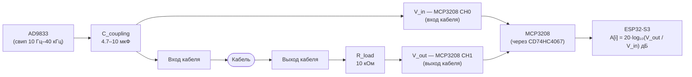

# Разбор блока АЧХ · Минимальные требования и методика

## Зачем этот документ

АЧХ — наиболее технически сложный тест из трёх. Он выглядит логично: «подать синус на вход, измерить уровень на выходе». После перехода на MCP3208 (100 кSPS, [ADR-009](../../docs/adr/009-mcp3208-selection.md)) прямая оцифровка сигнала возможна во всём диапазоне 10 Гц – 40 кГц. Однако на верхней границе (40 кГц) MCP3208 даёт лишь 2.5 выборки за цикл — недостаточно для прямого поиска пика. Ключевой приём: **оценка амплитуды через RMS** вместо поиска максимума.

Документ нужен Владу (прошивка) и Ване (железо, схема). Читается до разводки аналогового тракта.

---

## Что измеряется в контексте этого проекта

АЧХ передачи сигнала показывает, как кабель изменяет амплитуду синусоидального сигнала в зависимости от частоты. Хороший кабель «прозрачен» в слышимом диапазоне: ослабление одинаково на всех частотах. Плохой кабель режет ВЧ (ёмкостная нагрузка) или ведёт себя непредсказуемо (повреждённые экраны, дефекты пайки).

**30 точек, логарифмически распределённых от 10 Гц до 40 кГц** — таблица частот зафиксирована в [BLE-протоколе §4](ble-protocol.md). Изменение любой точки — ломающее изменение протокола.

Результат нормируется на значение при 1 кГц (индекс 16 в таблице): $v[i] = A(f_i) - A(1000\,\text{Гц})$ в дБ. Значение $v[16]$ всегда равно $0.0$.

**Пороги из [ФТТ](requirements.md) (ФТ-2.2):**

| Статус        | Условие                                       | Примечание               |
| ------------- | --------------------------------------------- | ------------------------ |
| `"excellent"` | Отклонение ≤ ±1 дБ в диапазоне 20 Гц – 20 кГц | Профессиональный уровень |
| `"ok"`        | Отклонение ≤ ±3 дБ                            | Рабочий кабель           |
| `"fail"`      | Отклонение > ±3 дБ или пропадание сигнала     | Кабель с дефектом        |

---

## MCP3208 и прямое оцифровывание аудиочастот

MCP3208 работает на **100 кSPS** — частота Найквиста 50 кГц, что перекрывает весь рабочий диапазон 10 Гц – 40 кГц. Прямое сэмплирование сигнала возможно на всех 30 точках таблицы.

| Частота    | Выборок за цикл | Метод оценки амплитуды  |
| ---------- | --------------- | ----------------------- |
| 10–100 Гц  | 1 000–86        | RMS по 5+ полным циклам |
| 131–730 Гц | 65–11           | RMS по N выборкам       |
| 1–40 кГц   | 100–2.5         | RMS по 256 выборкам     |

На 40 кГц — всего 2.5 выборки/цикл. Прямой поиск максимума здесь ненадёжен. Решение: **оценка через RMS** — выборки попадают в случайные фазы, и среднеквадратичное значение сходится к истинному независимо от фазы.

Формулы оценки амплитуды через накопленные суммы (без буфера):

$$V_\text{rms} = \sqrt{\frac{\sum x_i^2}{N} - \left(\frac{\sum x_i}{N}\right)^2}$$

Вычитание квадрата среднего ($\langle x \rangle^2$) снимает DC-составляющую, что необходимо из-за смещения нуля AD9833.

$$V_\text{peak} = V_\text{rms} \cdot \sqrt{2} \qquad \text{(справедливо для синусоиды)}$$

При 256 выборках на 40 кГц (2.56 мс): покрывается ~64 цикла, SNR оценки амплитуды ≈ 40 дБ — погрешность < 0.1 дБ, что на порядок лучше требуемого ±3 дБ.

---

## Требования к сигнальному тракту



### Источник сигнала: AD9833

AD9833 генерирует синус с плоской АЧХ в диапазоне 10 Гц – 40 кГц при нагрузке с высоким импедансом (> 10 кОм). Выходное напряжение: 0–0.65 В (VOUT в конфигурации с одним выходом) или до 1.65 В с делителем. Выходной импеданс: ~200 Ом типично.

**Требование к источнику:**

- Перед измерением выждать **не менее 10 периодов** на каждой частоте после переключения — AD9833 перестраивается за ~1 мкс, но фазовые переходные процессы могут давать ложные показания
- Амплитуда выхода AD9833 должна оставаться постоянной во время всего свипа (настраивается через регистр FREQ0)

### Схема измерения: два канала мультиплексора

MCP3208 подключается к CD74HC4067 через два выделенных канала:

1. **Канал V_in** — сигнал на входе кабеля (после конденсатора AC-связи)
2. **Канал V_out** — сигнал на выходе кабеля (после нагрузочного резистора)

MCP3208 переключается между ними поочерёдно. Пиковый детектор **не требуется** — прямое оцифровывание через RMS.

### Опционально: пиковый детектор для повышения точности

Если MCP3208 будет использоваться ещё и для CMRR (медленные измерения), добавление пикового детектора на одну половину U8 (TL072/OPA2134) даёт более быструю и стабильную оценку амплитуды на высоких частотах — но для MVP не является обязательным требованием.

### Связь и DC-составляющая

AD9833 выдаёт синус с DC-смещением ~AVDD/2. Нужна AC-связь (конденсатор последовательно) между выходом AD9833 и входом кабеля, иначе DC-смещение насыщает вход MCP3208 (VREF = 3.3 В, нет двухполярного питания).

Минимальная ёмкость конденсатора AC-связи:

$$C_\text{coupling} \geq \frac{1}{2\pi \cdot R_\text{load} \cdot f_\text{min}}$$

При $R_\text{load} = 10\,\text{кОм}$, $f_\text{min} = 10\,\text{Гц}$:

$$C_\text{coupling} \geq \frac{1}{2\pi \times 10\,000 \times 10} \approx 1.6\,\text{мкФ}$$

Взять 4.7–10 мкФ плёночный конденсатор (не электролит — полярный не подходит для двустороннего сигнала).

---

## Алгоритм измерения

### Цикл на одну частотную точку

```
1. Установить AD9833 → f[i]
2. Ждать T_settle(f[i]) — переходные процессы сходят
3. Переключить мультиплексор на V_in-канал
4. Снять N(f[i]) отсчётов MCP3208, накапливать sum и sum_sq (потоково, без буфера)
5. Вычислить V_in,rms и V_in,peak
6. Переключить мультиплексор на V_out-канал
7. Снять N(f[i]) отсчётов → V_out,rms → V_out,peak
8. Вычислить A[i] в дБ
```

**Расчётные формулы (шаги 5, 7, 8):**

$$V_\text{rms} = \sqrt{\frac{\textit{sum\_sq}}{N} - \left(\frac{\textit{sum}}{N}\right)^2} \qquad V_\text{peak} = V_\text{rms} \cdot \sqrt{2}$$

$$A[i] = 20 \log_{10}\!\left(\frac{V_{\text{out,peak}}}{V_{\text{in,peak}}}\right)\,\text{дБ}$$

Итоговый нормированный массив:

$$v[i] = A[i] - A[16] \qquad \text{(нормировка на 1 кГц; } v[16] \equiv 0.0\text{)}$$

RMS-расчёт использует потоковую формулу — хранить два числа (`sum`, `sum_sq`), не весь массив выборок.

### Число выборок N и время на точку

| Частота      | N выборок (≥5 циклов) | Время снятия | T_settle  |
| ------------ | --------------------- | ------------ | --------- |
| 10–24 Гц     | 50 000–20 000         | 500–200 мс   | 2 периода |
| 31–99 Гц     | 16 000–5 100          | 160–51 мс    | 2 периода |
| 131–730 Гц   | 3 800–700             | 38–7 мс      | 10 мс     |
| 1 кГц–40 кГц | 256 (фикс.)           | 2.56 мс      | 5 мс      |

**Суммарное время свипа (30 точек, вход + выход × 2):**

- Точки 0–3 (10–24 Гц): ≈ 2.8 с
- Точки 4–8 (31–99 Гц): ≈ 1.1 с
- Точки 9–15 (131–730 Гц): ≈ 0.3 с
- Точки 16–29 (1–40 кГц): ≈ 0.21 с
- **Итого: ≈ 4.5 секунды** — значительно быстрее прежней оценки и в пределах ≤ 30 с по ФТТ

```mermaid
gantt
    title Время одного свипа (30 точек)
    dateFormat  s
    axisFormat  %Sс
    section Низкие частоты
    10–24 Гц (точки 0–3)    : 0, 2.8s
    section Средние частоты
    31–99 Гц (точки 4–8)    : 2.8s, 1.1s
    131–730 Гц (точки 9–15) : 3.9s, 0.3s
    section Высокие частоты
    1–40 кГц (точки 16–29)  : 4.2s, 0.21s
```

### Пропадание сигнала

Если $V_{\text{out,rms}}[i] < 3\,\text{мВ}$ (порог шума) — сигнал не прошёл через кабель. Записать $v[i] = -99.0$ как sentinel-значение, выставить `status = "fail"` независимо от остальных точек.

---

## Методика калибровки

### Шаг 1 — Калибровка уровня источника

AD9833 имеет типовой разброс выходной амплитуды ±10% между экземплярами. Перед первым использованием:

- Подключить выход AD9833 напрямую к V_in-каналу MCP3208 через AC-связь (без кабеля)
- Свипировать все 30 частот, записать $V_{\text{in,direct}}[i]$
- Рассчитать поправочные коэффициенты:

$$k[i] = \frac{V_{\text{in,direct}}[16]}{V_{\text{in,direct}}[i]}$$

- Записать $k[i]$ в NVS

Применять к результатам:

$$A_\text{corrected}[i] = A[i] + 20 \log_{10}(k[i])$$

Это корректирует неплоскостность собственной АЧХ источника (AD9833 + обвязка). Поправка обычно < 0.5 дБ в диапазоне 100 Гц – 40 кГц, но может достигать 1–2 дБ на частотах < 50 Гц из-за конденсатора AC-связи.

### Шаг 2 — Калибровка потолка динамического диапазона

Подключить вход и выход прибора коротким проводником (прямая перемычка, 0 дБ). Провести полный свип. Максимальное отклонение от 0 дБ на всех частотах — это **собственная неравномерность прибора** ($\delta_\text{floor}$).

Если $\delta_\text{floor} > \pm 1\,\text{дБ}$ на каком-либо участке — прибор не готов к измерению кабелей в категории `"excellent"`. Искать причину в AC-связи (завал НЧ) или в недостаточном числе выборок N (завал ВЧ при малом N).

### Шаг 3 — Калибровка на эталонном кабеле

- Взять **заведомо хороший** кабель (новый, короткий, от известного производителя). Ожидаемый результат: отклонение < ±0.5 дБ до 20 кГц
- Взять **заведомо плохой** кабель (старый, с повреждённым экраном или дешёвый несимметричный длиной > 5 м). Ожидаемый результат: заметный завал ВЧ от 5–10 кГц

Результаты зафиксировать в `docs/hardware/freq-response-calibration.md` как baseline.

---

## Критерий готовности к демо

К **12 мая** (конец недели 4, Этап 2, дорожная карта) тест АЧХ считается готовым, если:

- [ ] Короткая перемычка (0 дБ) показывает отклонение < ±1 дБ во всём диапазоне 10 Гц – 40 кГц
- [ ] Эталонный хороший кабель устойчиво показывает `status = "excellent"` или `"ok"`
- [ ] Эталонный плохой кабель показывает завал от эталонного хотя бы на 3 дБ на одной из точек выше 10 кГц
- [ ] Полный свип (30 точек) завершается за < 15 секунд
- [ ] Прогресс-бар приложения корректно отображает продвижение по частотам (обновление STATUS `progress` при каждом шаге)

Если к 10 мая критерий CMRR не выполнен (см. [scope-triggers.md](scope-triggers.md), Б-минус 1) — АЧХ урезается до **5–7 опорных частот** вместо полных 30: 20 Гц, 100 Гц, 1 кГц, 5 кГц, 10 кГц, 20 кГц (и опционально 40 кГц). Это не меняет протокол — массив `v[30]` остаётся, пропущенные точки заполняются `null` или `0.0`.

---

## Типичные проблемы и как их распознать

| Симптом                                                   | Вероятная причина                                                                        | Что делать                                                                                                                                                                                                                                                    |
| --------------------------------------------------------- | ---------------------------------------------------------------------------------------- | ------------------------------------------------------------------------------------------------------------------------------------------------------------------------------------------------------------------------------------------------------------- |
| Завал АЧХ уже от 100 Гц                                   | Конденсатор AC-связи слишком мал                                                         | Увеличить $C_\text{coupling}$ до 4.7–10 мкФ                                                                                                                                                                                                                   |
| Неравномерность 2–3 дБ на ВЧ                              | Слишком мало выборок N на 1–40 кГц                                                       | Увеличить N до 512–1024; время вырастет незначительно                                                                                                                                                                                                         |
| Значения скачут между запусками                           | N недостаточно или T_settle слишком короткое                                             | Увеличить N и T_settle; для < 100 Гц — брать не менее 5 полных циклов                                                                                                                                                                                         |
| Завал только на 10–30 Гц, выше — норма                    | Конденсатор AC-связи разряжается во время долгого набора выборок                         | Проверить ёмкость $C_\text{coupling}$; для низкочастотных точек это ожидаемо — увеличить $C_\text{coupling}$                                                                                                                                                  |
| RMS даёт нулевое значение на всех частотах                | DC-смещение AD9833 не убрано (нет AC-связи)                                              | Проверить конденсатор $C_\text{coupling}$: без него $\langle x \rangle \approx \text{AVDD}/2$, а $V_\text{rms} \approx 0$                                                                                                                                     |
| Значение зависит от длины кабеля (не только его качества) | Нормально: ёмкость кабеля с нагрузочным резистором образует фильтр НЧ                    | Добавить типичную нагрузку ~10 кОм на выход кабеля, указать это в условиях измерения                                                                                                                                                                          |
| При оборванном кабеле V_out не ноль, а малый сигнал       | Прямая наводка от выходного тракта на V_out-канал MCP3208 (ёмкостная связь через воздух) | На 40 кГц при аккуратной разводке — ≤ 0.05 дБ ошибки (несущественно для критерия ±1 дБ). Обрыв при этом всё равно детектируется: V_out остаётся $\leq -46\,\text{дБ}$ → `status = "fail"`. Подробно о наводках — [cmrr-requirements.md](cmrr-requirements.md) |

---

## Итого

АЧХ — самый технически ёмкий тест. Ключевое:

1. **MCP3208 покрывает весь диапазон** — прямое оцифровывание от 10 Гц до 40 кГц, пиковый детектор не является обязательным компонентом
2. **RMS вместо пика** — два текущих числа (`sum`, `sum_sq`) вместо буфера; работает даже при 2.5 выборках/цикл на 40 кГц
3. Время свипа ~4.5 секунды — существенно быстрее прежней оценки; проблем с лимитом ≤ 30 с нет
4. Калибровочный массив $k[i]$ хранится в NVS — выполняется один раз при сборке
5. Если CMRR не готов к 10 мая, АЧХ урезается до 5–7 точек — протокол при этом не меняется
