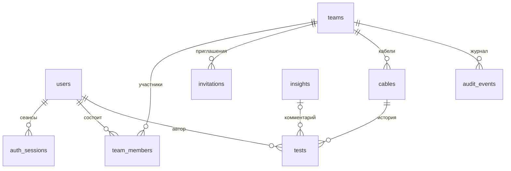

# Модель данных Himo Hub

Версия 0.2 · Октябрь 2026

Требования → [requirements.md](requirements.md) · Синхронизация → [sync.md](sync.md) · Архитектура → [architecture.md, раздел 6](../architecture.md#6-himo-hub) · Стек → [ADR-015](../../adr/015-hub-stack.md) · Прокси ИИ-комментариев → [ADR-018](../../adr/018-insights-proxy.md)

Схема PostgreSQL для Himo Hub и правила работы с ней: синхронизация с приложением, идемпотентная выгрузка, конфликты, удаление. Модель рассчитана на MVP: там, где требование можно закрыть кодом приложения или простым запросом, схема не усложняется.

---

## 1. Общие принципы

- **PostgreSQL 14.** Миграции — goose, применяются при старте сервера; запросы — sqlc ([ADR-015](../../adr/015-hub-stack.md)).
- **Идентификаторы — UUIDv7** (RFC 9562), тип `uuid`. Кабели и тесты получают ID в приложении, остальные сущности — на сервере в Go. Встроенной `uuidv7()` в PostgreSQL 14 нет, поэтому у первичных ключей нет `DEFAULT`. Исключение — `auth_sessions` и `audit_events`: это внутренние таблицы, их ID не появляются в адресах, им достаточно `bigint GENERATED ALWAYS AS IDENTITY`.
- **Время** — `timestamptz`, хранится момент в UTC.
- **Перечисления** — `text` с `CHECK`, а не `CREATE TYPE … AS ENUM`: значения проще менять миграциями, а типизированные перечисления в Go и TypeScript генерируются из контракта OpenAPI.
- **Результаты измерений** — одно поле `tests.results jsonb` в формате BLE-протокола (раздел 4).
- **Удаление окончательное**, кроме двух случаев: команда удаляется мягко (восстановление в течение 30 суток), пользователь обезличивается (тесты сохраняют автора).
- **Изоляция команд** обеспечивается запросами: каждый запрос к данным команды проверяет членство пользователя в ней. Row-Level Security не используется.

---

## 2. Схема связей



| Таблица         | Что хранит                                                  | Требования   |
| --------------- | ----------------------------------------------------------- | ------------ |
| `users`         | Учётные записи                                              | HUB-1        |
| `auth_sessions` | Сеансы веба и приложения                                    | HUB-1        |
| `teams`         | Команды, в том числе личные пространства; счётчик изменений | HUB-2, HUB-3 |
| `team_members`  | Участники и роли                                            | HUB-2        |
| `invitations`   | Одноразовые приглашения                                     | HUB-2        |
| `cables`        | Кабели                                                      | HUB-4        |
| `tests`         | Тесты с результатами                                        | HUB-5        |
| `insights`      | Кэш ИИ-комментариев                                         | HUB-10       |
| `audit_events`  | Журнал действий команды                                     | HUB-9        |

---

## 3. Таблицы

```sql
-- Пользователи. Строки не удаляются физически: при удалении учётной записи
-- стираются пароль и Telegram, автор тестов показывается как «Удалённый пользователь».
CREATE TABLE users (
    id                 uuid        PRIMARY KEY,
    nickname           text        NOT NULL,
    password_hash      text,                      -- NULL у удалённых
    telegram_id        bigint      UNIQUE,
    telegram_username  text,
    created_at         timestamptz NOT NULL DEFAULT now(),
    deleted_at         timestamptz
);
-- Ник уникален без учёта регистра среди действующих пользователей.
CREATE UNIQUE INDEX users_nickname_uq ON users (lower(nickname)) WHERE deleted_at IS NULL;

-- Сеансы: refresh-токены приложения и сеансы веба.
CREATE TABLE auth_sessions (
    id          bigint      GENERATED ALWAYS AS IDENTITY PRIMARY KEY,
    user_id     uuid        NOT NULL REFERENCES users ON DELETE CASCADE,
    token_hash  bytea       NOT NULL UNIQUE,      -- SHA-256 токена, сам токен не хранится
    client      text        NOT NULL CHECK (client IN ('web', 'app')),
    created_at  timestamptz NOT NULL DEFAULT now(),
    expires_at  timestamptz NOT NULL,
    revoked_at  timestamptz
);
CREATE INDEX auth_sessions_user_idx ON auth_sessions (user_id);

-- Команды, в том числе личные пространства.
CREATE TABLE teams (
    id           uuid        PRIMARY KEY,
    name         text        NOT NULL,
    description  text        NOT NULL DEFAULT '',
    is_personal  boolean     NOT NULL DEFAULT false,
    plan         text        NOT NULL DEFAULT 'free',  -- ключ тарифа, лимиты — в конфигурации
    change_seq   bigint      NOT NULL DEFAULT 0,       -- счётчик изменений для синхронизации
    created_at   timestamptz NOT NULL DEFAULT now(),
    deleted_at   timestamptz                           -- восстановление в течение 30 суток
);

CREATE TABLE team_members (
    team_id    uuid        NOT NULL REFERENCES teams ON DELETE CASCADE,
    user_id    uuid        NOT NULL REFERENCES users,
    role       text        NOT NULL CHECK (role IN ('owner', 'member')),
    joined_at  timestamptz NOT NULL DEFAULT now(),
    PRIMARY KEY (team_id, user_id)
);
-- Не больше одного владельца в команде.
CREATE UNIQUE INDEX team_members_owner_uq ON team_members (team_id) WHERE role = 'owner';
CREATE INDEX team_members_user_idx ON team_members (user_id);

-- Одноразовые приглашения.
CREATE TABLE invitations (
    id          uuid        PRIMARY KEY,
    team_id     uuid        NOT NULL REFERENCES teams ON DELETE CASCADE,
    token_hash  bytea       NOT NULL UNIQUE,
    created_by  uuid        NOT NULL REFERENCES users,
    created_at  timestamptz NOT NULL DEFAULT now(),
    expires_at  timestamptz NOT NULL,
    revoked_at  timestamptz,
    used_by     uuid        REFERENCES users,
    used_at     timestamptz,
    CHECK ((used_by IS NULL) = (used_at IS NULL))
);
CREATE INDEX invitations_team_idx ON invitations (team_id);

CREATE TABLE cables (
    id           uuid        PRIMARY KEY,          -- UUIDv7 из приложения
    team_id      uuid        NOT NULL REFERENCES teams ON DELETE CASCADE,
    name         text        NOT NULL,
    cable_type   text        NOT NULL CHECK (cable_type IN ('jack_ts', 'jack_trs', 'xlr')),
    color        text        NOT NULL CHECK (color ~ '^[0-9a-f]{6}$'),
    note         text,
    assignee_id  uuid        REFERENCES users,
    created_by   uuid        NOT NULL REFERENCES users,
    created_at   timestamptz NOT NULL,             -- время создания в приложении
    updated_at   timestamptz NOT NULL DEFAULT now(),
    version      integer     NOT NULL DEFAULT 1,   -- оптимистичная блокировка
    archived_at  timestamptz,
    change_seq   bigint      NOT NULL
);
CREATE INDEX cables_team_seq_idx ON cables (team_id, change_seq);

-- Кэш ИИ-комментариев (ADR-018).
CREATE TABLE insights (
    id              uuid        PRIMARY KEY,
    cache_key       bytea       NOT NULL UNIQUE,   -- SHA-256(канонические результаты + версия промпта + модель)
    prompt_version  text        NOT NULL,
    model           text        NOT NULL,
    body            text        NOT NULL,
    created_at      timestamptz NOT NULL DEFAULT now()
);
-- Для дневного лимита обращений к модели: count(*) за текущие сутки.
CREATE INDEX insights_created_idx ON insights (created_at);

CREATE TABLE tests (
    id                   uuid        PRIMARY KEY,  -- UUIDv7 из приложения
    cable_id             uuid        NOT NULL REFERENCES cables ON DELETE CASCADE,
    author_id            uuid        NOT NULL REFERENCES users,  -- кто выгрузил
    measured_at          timestamptz NOT NULL,     -- часы приложения
    received_at          timestamptz NOT NULL DEFAULT now(),
    device_id            text        NOT NULL,
    pv                   smallint    NOT NULL,
    app_version          text        NOT NULL,
    rules_version        text        NOT NULL,
    firmware_version     text,
    health_score         smallint    CHECK (health_score BETWEEN 0 AND 100),
    health_incomplete    boolean     NOT NULL,
    note                 text,
    results              jsonb       NOT NULL,     -- раздел 4
    payload_hash         bytea       NOT NULL,     -- для идемпотентной выгрузки
    insight_id           uuid        REFERENCES insights ON DELETE SET NULL,
    invalidated_at       timestamptz,
    invalidated_by       uuid        REFERENCES users,
    invalidation_reason  text,
    change_seq           bigint      NOT NULL,
    CHECK ((invalidated_at IS NULL) = (invalidated_by IS NULL)
       AND (invalidated_at IS NULL) = (invalidation_reason IS NULL))
);
-- История кабеля, предыдущий и эталонный тест, последний тест для каталога.
CREATE INDEX tests_cable_history_idx ON tests (cable_id, measured_at, id);
CREATE INDEX tests_cable_seq_idx     ON tests (cable_id, change_seq);

-- Журнал действий команды. Ссылок на кабели и тесты нет намеренно:
-- записи должны пережить окончательное удаление кабеля.
CREATE TABLE audit_events (
    id               bigint      GENERATED ALWAYS AS IDENTITY PRIMARY KEY,
    team_id          uuid        NOT NULL REFERENCES teams ON DELETE CASCADE,
    actor_id         uuid        NOT NULL REFERENCES users,
    event            text        NOT NULL,         -- раздел 3.6
    cable_id         uuid,
    test_id          uuid,
    subject_user_id  uuid        REFERENCES users, -- кого пригласили, исключили, назначили
    details          jsonb       NOT NULL DEFAULT '{}',  -- было / стало, имя кабеля
    created_at       timestamptz NOT NULL DEFAULT now()
);
CREATE INDEX audit_events_team_idx  ON audit_events (team_id, created_at DESC);
CREATE INDEX audit_events_cable_idx ON audit_events (cable_id) WHERE cable_id IS NOT NULL;
```

### 3.1 Пользователи и сеансы

- **Удаление учётной записи** — обезличивание: `deleted_at` ставится, `password_hash`, `telegram_id`, `telegram_username` стираются, сеансы удаляются. Строка остаётся, чтобы ссылки на автора тестов и журнала не ломались; интерфейс показывает «Удалённый пользователь». Ник освобождается для регистрации — уникальный индекс учитывает только действующих пользователей. Поэтому у ссылок на `users` нет `ON DELETE`: физически пользователи не удаляются.
- **Завершение всех сеансов** — `revoked_at` у всех строк `auth_sessions` пользователя. Смена пароля делает то же самое.
- Вид токенов — [ADR-022](../../adr/022-hub-authentication.md): один непрозрачный токен сеанса для веба и приложения, срок 30 суток с продлением при использовании. Таблица хранит его SHA-256.

### 3.2 Команды и участники

- **Личное пространство** — команда с `is_personal = true`, создаётся при регистрации. Приглашения в него и его удаление запрещены в коде.
- **Ровно один владелец.** Индекс `team_members_owner_uq` не даёт появиться второму; передача владения меняет роли двух строк в одной транзакции.
- **Уход и исключение участника** — удаление строки `team_members`. В той же транзакции у кабелей команды, где он ответственный, `assignee_id` сбрасывается в `NULL` с записью в журнал. Тесты и записи журнала сохраняют ссылку на автора.
- **Удаление команды** — `deleted_at`. Удалённая команда не видна ни в одном запросе: проверка членства соединяется с `teams` и отбрасывает такие команды. Восстановление — сброс `deleted_at`. Окончательная очистка команд, удалённых больше 30 суток назад, — каскадом от `teams`, отдельной командой CLI.
- **Тариф** — `teams.plan` хранит ключ, лимиты берутся из конфигурации (HUB-3), например `PLANS={"free": {"max_members": 5}}`. Команда CLI назначения тарифа проверяет ключ по конфигурации; для неизвестного ключа сервер применяет лимиты `free` и пишет предупреждение в лог.

### 3.3 Приглашения

Приглашение одноразовое. Действует, пока не истёк `expires_at` (по умолчанию 7 суток), нет `revoked_at` и нет `used_at`. Вступление в команду в одной транзакции проверяет лимит тарифа, добавляет участника и заполняет `used_by`, `used_at`. В БД хранится только хеш токена из ссылки.

### 3.4 Кабели

- **Ответственный** должен быть участником команды — проверяется в коде.
- **Тип нельзя изменить** после первого теста — проверяется в коде.
- **Архив** (`archived_at`) — кабель доступен только для чтения: изменения атрибутов и новые тесты отклоняются в коде.
- **Изменение атрибутов** — с оптимистичной блокировкой (раздел 5.4).
- **Окончательное удаление** — `DELETE` строки кабеля, тесты удаляются каскадом. Записи журнала остаются: имя кабеля сохранено в их `details`.
- **Цветная метка** — hex без `#` в нижнем регистре, как в приложении.

### 3.5 Тесты

- **Автор** (`author_id`) — пользователь, выгрузивший тест. Отдельного поля «кто измерял» нет: прибор не знает пользователя.
- Тест неизменяем. Меняются только пометка «недействительный» (`invalidated_at`, `invalidated_by`, `invalidation_reason`), ссылка на ИИ-комментарий `insight_id` и `change_seq`.
- **История кабеля** упорядочена по `(measured_at, id)`.
- **ИИ-комментарий.** При выгрузке сервер считает ключ кэша по результатам теста и текущим версиям промпта и модели. Если запись в `insights` уже есть, `insight_id` заполняется сразу. Иначе комментарий запрашивается при первом открытии теста в вебе и привязывается запросом `UPDATE … SET insight_id = $1 WHERE id = $2 AND insight_id IS NULL`. Привязанный комментарий не меняется. Привязка не увеличивает `change_seq`: приложение получает комментарии через `/insights`, а не синхронизацией.

### 3.6 Журнал действий

Запись не изменяется и не удаляется: в коде нет таких запросов. Журнал удаляется только вместе с командой.

| `event`                      | Объект                        | `details`                                 |
| ---------------------------- | ----------------------------- | ----------------------------------------- |
| `member.joined`              | `subject_user_id`             | ID приглашения                            |
| `member.left`                | `subject_user_id`             | —                                         |
| `member.removed`             | `subject_user_id`             | —                                         |
| `invitation.created`         | —                             | ID приглашения, срок действия             |
| `invitation.revoked`         | —                             | ID приглашения                            |
| `team.updated`               | —                             | было / стало: название, описание          |
| `team.ownership_transferred` | `subject_user_id`             | прежний владелец                          |
| `cable.created`              | `cable_id`                    | имя, тип                                  |
| `cable.updated`              | `cable_id`                    | было / стало по изменённым атрибутам      |
| `cable.assignee_changed`     | `cable_id`, `subject_user_id` | было / стало                              |
| `cable.archived`             | `cable_id`                    | имя                                       |
| `cable.unarchived`           | `cable_id`                    | имя                                       |
| `cable.deleted`              | `cable_id`                    | имя, тип, число тестов                    |
| `test.uploaded`              | `cable_id`, `test_id`         | имя кабеля, время измерения, Health Score |
| `test.invalidated`           | `cable_id`, `test_id`         | причина                                   |
| `test.revalidated`           | `cable_id`, `test_id`         | прежняя причина                           |

Список не закреплён в схеме: новый тип события добавляется без миграции.

---

## 4. Формат результатов

`tests.results` — объект с ключами `continuity`, `cmrr`, `freq_response`. Ключ есть, только если измерение выполнено; хотя бы одно измерение обязательно. Имена и значения полей — как в [BLE-протоколе](../device/ble-protocol.md); служебные поля пакета (`type`, `pv`, `ts`, `cable`) в результаты не входят — они хранятся в колонках теста или берутся из кабеля.

**Частоты АЧХ в БД не хранятся.** Таблица частот — часть протокола и однозначно определяется `pv`: её изменение по правилам протокола требует новой версии `pv`. Сервер держит таблицы частот всех поддерживаемых версий в коде и при выдаче теста через API добавляет к `v` массив частот `f` по `pv` теста — так выполняется требование HUB-5 хранить отклонения вместе с частотами.

Пример для `xlr`:

```json
{
  "continuity": {
    "status": "ok",
    "conductors": {
      "pin1": { "r": 0.91, "s": "ok" },
      "pin2": { "r": 1.02, "s": "ok" },
      "pin3": { "r": 0.95, "s": "ok" }
    }
  },
  "cmrr": { "status": "excellent", "cmrr_db": 72.4 },
  "freq_response": {
    "status": "ok",
    "v": [0.1, 0.1, 0.1, 0.0, 0.0, 0.0, 0.0, 0.0, 0.0, 0.0, 0.0, 0.0, 0.0, 0.0, 0.0, 0.0, 0.0, 0.0, 0.0, 0.0, 0.0, -0.1, -0.2, -0.3, -0.5, -0.7, -1.0, -1.5, -2.3, -3.8]
  }
}
```

Структуру проверяет сервер при выгрузке (HUB-5): значения перечислений, состав проводников по типу кабеля (`jack_ts` — `tip`, `sleeve`; `jack_trs` — `tip`, `ring`, `sleeve`; `xlr` — `pin1`–`pin3`), отсутствие CMRR у `jack_ts`, 30 точек АЧХ, диапазоны чисел. Незнакомые поля внутри измерений сохраняются как есть — так выполняется требование о совместимом расширении протокола.

Почему `jsonb`, а не отдельные таблицы измерений: результаты всегда читаются целиком вместе с тестом, сравнение и графики строятся в коде, а графики динамики нужны в пределах одного кабеля — это сотни тестов, и запросы к `jsonb` с ними справляются. Заодно без лишних усилий сохраняются незнакомые поля и проще считается хеш содержимого.

---

## 5. Синхронизация с приложением

Здесь — серверная сторона: как выдаются номера изменений и какими запросами строятся ответы. Протокол со стороны приложения — запросы, курсор, первая загрузка, реакция на отказы и конфликты — **[sync.md](sync.md)**.

### 5.1 Счётчик изменений команды

Инкрементальная загрузка (HUB-7) отвечает на вопрос «что изменилось после отметки N». Отметка должна гарантировать: если приложение видело N, изменение с меньшим номером уже не появится. Курсор по времени или по глобальной последовательности этого не гарантирует — номер выдаётся в начале транзакции, а фиксируется она позже, и транзакция с меньшим номером может стать видна после транзакции с бо́льшим.

Поэтому у каждой команды свой счётчик `teams.change_seq`. Пишущая транзакция начинает с

```sql
UPDATE teams SET change_seq = change_seq + $n WHERE id = $team RETURNING change_seq;
```

где `$n` — число изменяемых объектов, и раздаёт им номера из полученного диапазона, записывая их в `cables.change_seq` или `tests.change_seq`. `UPDATE` блокирует строку команды до конца транзакции, поэтому внутри команды номера выдаются в порядке фиксации. Записи разных команд друг друга не блокируют.

Счётчик увеличивают: создание кабеля, изменение атрибутов (в том числе ответственного, в том числе сброс при уходе участника), архивирование и возврат из архива, новый тест, пометка «недействительный» и её снятие.

`change_seq` и `cables.version` — разные вещи: первый нужен синхронизации («что нового»), вторая — конфликтам правок.

### 5.2 Загрузка

Приложение хранит курсор отдельно для каждой команды и передаёт список кабелей, которые оно отслеживает.

```sql
-- изменённые кабели
SELECT … FROM cables
WHERE team_id = $team AND id = ANY($tracked) AND change_seq > $cursor;

-- новые и изменённые тесты, постранично
SELECT … FROM tests
WHERE cable_id = ANY($tracked) AND change_seq > $cursor
ORDER BY change_seq LIMIT 100;

-- кабели, которых больше нет
SELECT unnest($tracked::uuid[]) EXCEPT SELECT id FROM cables WHERE team_id = $team;
```

- Новый курсор — наибольший `change_seq` в ответе; когда изменений больше нет — `teams.change_seq`, прочитанный в той же транзакции.
- Первая загрузка кабеля — тот же запрос с курсором 0 и одним этим кабелем. Как приложение обновляет курсор команды после неё — [sync.md, раздел 6.1](sync.md#61-правило-курсора-при-первой-загрузке).
- Все запросы одного ответа выполняются в одной транзакции `REPEATABLE READ`, поэтому кабели, тесты, удалённые кабели и курсор согласованы между собой.
- **Удаление** отдельно не хранится. Кабели из списка приложения, которых нет в команде, возвращаются как удалённые — приложение перестаёт их синхронизировать. «Удалён» и «нет доступа» для приложения неразличимы и не требуют разной реакции.
- Бывший участник получает отказ «нет доступа к команде» на этапе проверки членства.

### 5.3 Идемпотентная выгрузка

**Тест.** `payload_hash` — SHA-256 канонического представления выгруженного теста: метаданные от приложения и результаты, без серверных полей (`received_at`, `insight_id`, пометка недействительности, `change_seq`). Выгрузка:

```sql
INSERT INTO tests (…) VALUES (…) ON CONFLICT (id) DO NOTHING RETURNING id;
```

Если строка не вставилась, сервер сравнивает хеш: совпал — ответ как при первой выгрузке, не совпал — отказ «конфликт идентификатора».

**Кабель.** Атрибуты кабеля меняются, поэтому содержимое при повторе не сравнивается. Кабель с таким ID уже есть в той же команде — выгрузка принята, в ответе актуальное состояние кабеля с версией. Есть в другой команде — отказ.

Выгрузка теста в кабель, которого нет на сервере, отклоняется как «кабель не найден». Приложение знает, выгружало ли оно этот кабель раньше, и в этом случае показывает, что кабель удалён.

**Пакет выгрузки** — одна транзакция, у каждого объекта своя точка сохранения (`SAVEPOINT`): ошибка объекта откатывает только его ([ADR-023](../../adr/023-hub-api-conventions.md)). Пакет может затрагивать несколько команд, поэтому строки `teams` для выдачи номеров блокируются в начале транзакции одним запросом в порядке ID — так два пакета не заблокируют друг друга:

```sql
SELECT id FROM teams WHERE id = ANY($teams) ORDER BY id FOR UPDATE;
```

### 5.4 Конфликт атрибутов кабеля

Правка приходит со всеми изменяемыми атрибутами и с той версией, от которой она сделана:

```sql
UPDATE cables
SET name = $name, cable_type = $cable_type, color = $color, note = $note, assignee_id = $assignee_id,
    version = version + 1, updated_at = now(), change_seq = $seq
WHERE id = $id AND version = $version AND archived_at IS NULL
RETURNING version;
```

- Строка обновилась — правка принята.
- Не обновилась — сервер отвечает «конфликт» и возвращает актуальное состояние. Как приложение показывает расхождение и выбирает версию — [sync.md, раздел 4](sync.md#4-конфликт-атрибутов-кабеля).

Правка, принятая после конфликта, проходит как обычное изменение и попадает в журнал как `cable.updated` с «было / стало», поэтому откатить чужую правку незаметно нельзя. Слияния по отдельным полям нет: выбирается версия кабеля целиком.

---

## 6. Типовые запросы

**Каталог кабелей команды** — производные значения считаются при запросе, а не хранятся в кабеле:

```sql
SELECT c.*,
       last.measured_at   AS last_test_at,
       cur.health_score   AS current_health_score,
       cnt.n              AS test_count
FROM cables c
LEFT JOIN LATERAL (
    SELECT measured_at FROM tests
    WHERE cable_id = c.id
    ORDER BY measured_at DESC, id DESC LIMIT 1
) last ON true
LEFT JOIN LATERAL (
    SELECT health_score FROM tests
    WHERE cable_id = c.id AND invalidated_at IS NULL
    ORDER BY measured_at DESC, id DESC LIMIT 1
) cur ON true
LEFT JOIN LATERAL (
    SELECT count(*) AS n FROM tests WHERE cable_id = c.id
) cnt ON true
WHERE c.team_id = $team;
```

Фильтры и сортировки из HUB-4 накладываются поверх; цвет Health Score — диапазоны значений, пороги те же, что в приложении. В команде сотни кабелей, каждый `LATERAL` идёт по индексу `tests_cable_history_idx`. Если каталог станет медленным, первым шагом будет хранить эти значения в кабеле.

**Предыдущий действительный тест** — для сравнения по умолчанию (HUB-6):

```sql
SELECT … FROM tests
WHERE cable_id = $cable AND invalidated_at IS NULL
  AND (measured_at, id) < ($measured_at, $id)
ORDER BY measured_at DESC, id DESC LIMIT 1;
```

**Эталонный тест** — первый действительный: тот же запрос без условия на `(measured_at, id)` и с сортировкой по возрастанию.

---

## 7. Что проверяет код, а не схема

Эти правила зависят от других таблиц или неудобно выражаются ограничениями PostgreSQL 14:

- состав `results` соответствует типу кабеля (раздел 4);
- тип кабеля не меняется после первого теста;
- архивный кабель доступен только для чтения;
- ответственный — участник команды, при его уходе поле сбрасывается;
- в команде ровно один владелец (схема гарантирует только «не больше одного»);
- личное пространство — одно на пользователя, без приглашений и без удаления;
- лимит участников по тарифу при вступлении;
- удалённые команды исключаются из всех запросов;
- журнал действий не изменяется и не удаляется.

---

## История изменений

| Версия | Изменения                                                                                                                                                                                                                                                         |
| ------ | ----------------------------------------------------------------------------------------------------------------------------------------------------------------------------------------------------------------------------------------------------------------- |
| 0.1    | Исходная версия                                                                                                                                                                                                                                                   |
| 0.2    | Раздел 3.1 — вид токенов по [ADR-022](../../adr/022-hub-authentication.md). Раздел 5 — протокол со стороны приложения вынесен в [sync.md](sync.md); добавлены транзакция пакета выгрузки и снимок ответа загрузки; правка кабеля передаёт все изменяемые атрибуты |
